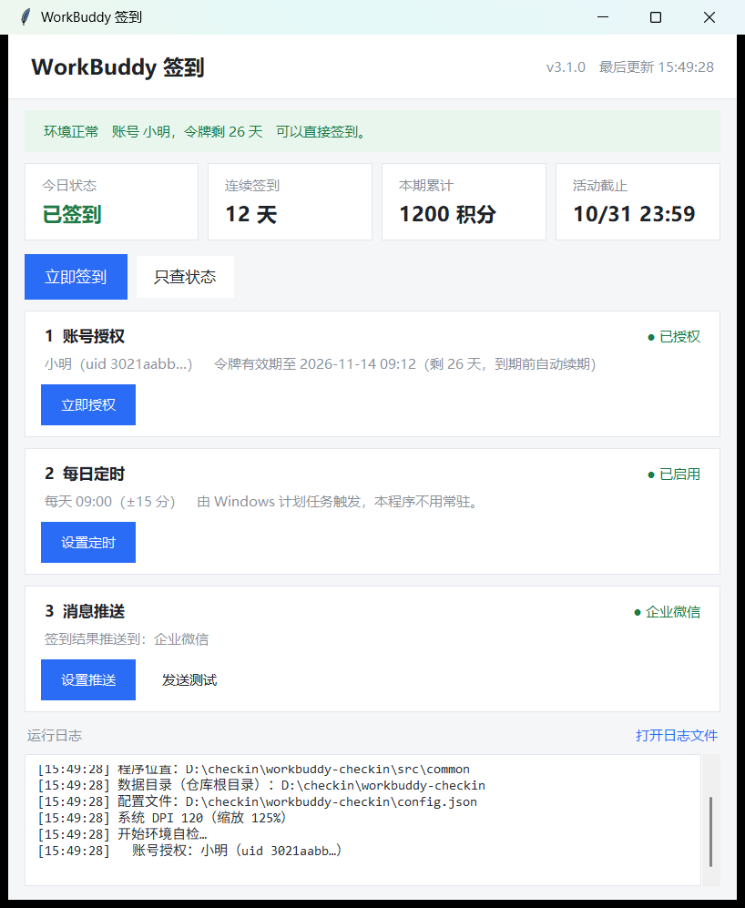
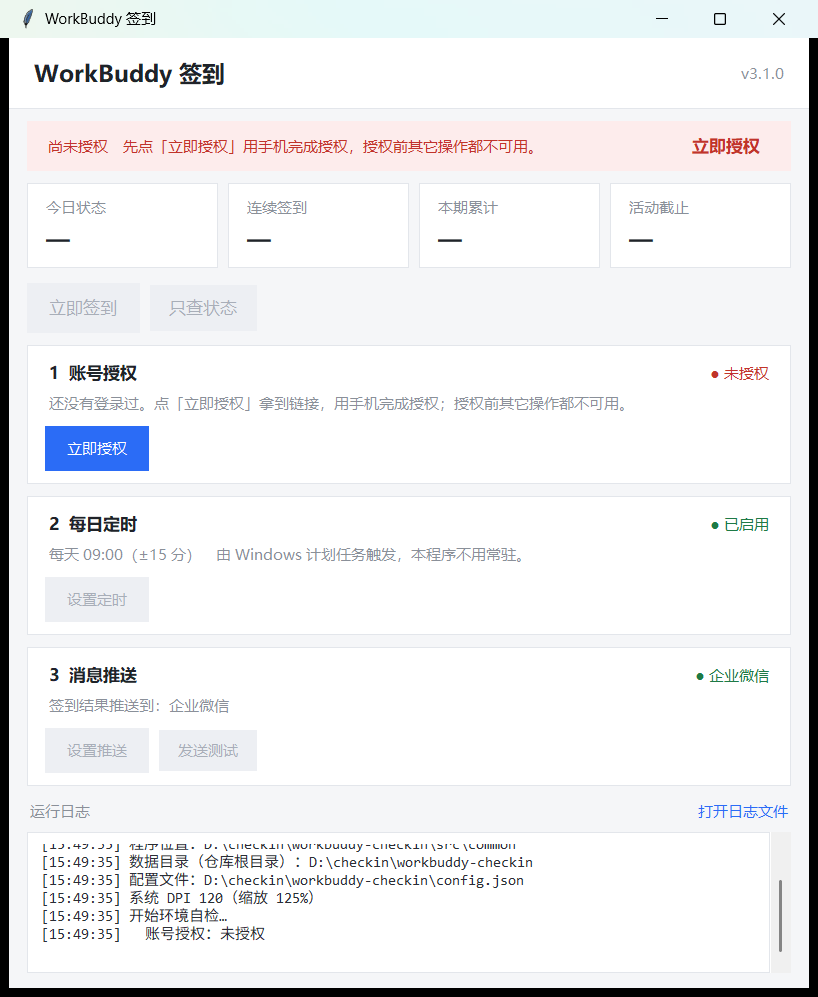
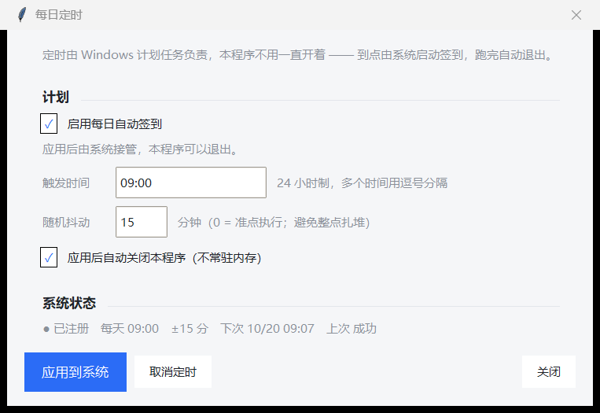
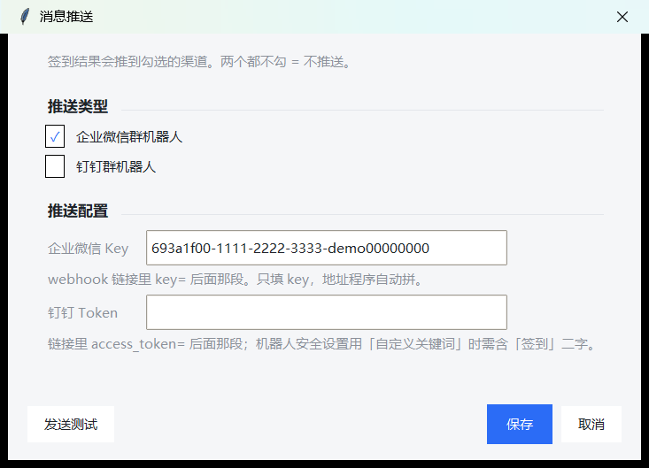

# WorkBuddy 每日签到

**账号直连**版签到工具：授权一次，之后纯 HTTP 请求签到，不依赖 WorkBuddy 客户端。

两个版本，各管一台机器，互不干扰：

| 版本 | 形态 | 适合 |
|---|---|---|
| **Windows 版** | 单文件 `WorkBuddyCheckin.exe`（带界面） | 自己的电脑：双击配置，计划任务每天自动跑 |
| **服务端版** | `wb_server.pyz` 单文件脚本（无界面） | 服务器 / NAS：交给 cron，授权链接推到手机上 |

两个版本各自授权、各存一份令牌，**同一账号只在一处跑**即可
（两边同时跑会互相踢掉，见 [授权机制](#授权机制)）。



---

## 快速开始

### Windows 版

1. 双击 `WorkBuddyCheckin.exe`（放哪都行，桌面、D 盘、U 盘都可以）
2. 「账号授权」→ **立即授权** → 复制链接到手机打开，登录确认
   （手机点完，程序自己会拿到令牌，电脑上不用再操作）
3. 「每日定时」→ 填时间 → **应用到系统**，程序随后可以关掉

之后每天到点由 Windows 计划任务拉起 `WorkBuddyCheckin.exe --run`，
跑完自动退出。**不需要装 Python，也不需要程序常驻。**

> 配置写在 `%LOCALAPPDATA%\WorkBuddyCheckin`，不写在 exe 旁边。
> 所以 exe 换目录、被移动都不丢配置；反过来，把 exe 拷给别人时
> 也不会把你的 key 一起带过去。

### 服务端版

```bash
# 1) 打一个单文件脚本（约 30 KB，不含 GUI / Windows 模块）
python3 build/make_server.py            # 产出 dist/server/wb_server.pyz

# 2) 只拷这一个文件，比如 /opt/wbcheckin
scp dist/server/wb_server.pyz server:/opt/wbcheckin/
cd /opt/wbcheckin

# 3) 生成配置模板，填机器人 key
python3 wb_server.pyz --init-config
python3 wb_server.pyz --check          # 体检：渠道、key、授权状态

# 4) 先手工跑一次（会推授权链接到手机，等 3 分钟）
python3 wb_server.pyz

# 5) 交给 cron
30 9 * * * cd /opt/wbcheckin && python3 wb_server.pyz >> checkin.log 2>&1
```

服务器上**只有这一个文件**。配置、日志、令牌都由它生成在同目录，
`--init-config` 写 `config.json`，不需要另拷模板或依赖目录。

> 别把 `src/` 拷到服务器：`src/desktop/` 里是 exe 版的界面（tkinter）、
> Windows 计划任务和弹窗抑制，服务器用不到。`make_server.py` 按
> `wb_server` 的 import 闭包把需要的模块打进 `.pyz`，闭包里一旦出现
> `checkin_gui` / `wb_task` / `win_quiet` 就直接报错。

`wb_server` 每次运行的顺序是固定的：

1. 检查授权：没有 / 损坏 / 失效 → 进入授权流程
2. 授权：推链接 → 等 180 秒 → 失败隔 60 秒再来（指数退避，最多 3 轮）
3. 拿到授权后立刻签到，结果推到同一批渠道
4. 3 轮都没成 → 推一条失败通知，退出码 `2`（cron 会因此报警）

---

## 界面说明

| 区域 | 内容 |
|---|---|
| 顶部横幅 | 环境状态一句话；授权缺失 / 失效 / 快到期 / 网络不通会直接给按钮 |
| 四张卡片 | 今日状态 / 连续签到 / 本期累计 / 活动截止 |
| 按钮区 | 立即签到、只查状态 |
| ① 账号授权 | 授权状态、到期时间 + 立即授权 |
| ② 每日定时 | 是否启用、每天几点、下次执行 + 设置定时 |
| ③ 消息推送 | 推到哪几个渠道 + 设置推送 / 发送测试 |
| 运行日志 | 全过程记录，右上角打开日志文件；首行写明程序位置与数据目录 |

**未授权时界面是锁住的**：除了「立即授权」，签到 / 只查状态 / 设置定时 /
设置推送全部灰掉，授权成功后自动恢复——不会出现"点了才报错"的按钮。

| 未授权（按钮全灰） | 每日定时 | 消息推送 |
|---|---|---|
|  |  |  |

---

## 数据放在哪

| 运行方式 | 数据目录 | 说明 |
|---|---|---|
| Windows 版（exe） | `%LOCALAPPDATA%\WorkBuddyCheckin` | 当前用户的缓存目录，exe 放哪都能跑 |
| 服务端版（单文件） | `wb_server.pyz` 所在目录 | 配置跟着脚本走，换机器只拷这一个文件 |
| 源码运行（开发） | 仓库根目录 | 调试用，不污染系统 |

三种位置都放同样的三样东西：

```
config.json        配置（推送 key、定时、提醒阈值）
auth_oauth.json    令牌（明文，等同于登录态，别提交、别外发）
checkin.log        运行日志（每次签到一行 JSON）
```

从 v2.x 升级上来时，第一次运行 exe 会把旧版留在 exe 旁边的
`config.json` / `auth_oauth.json` **复制**一份到缓存目录（源文件保留，
确认没问题后可以手工删掉）。

---

## 授权机制

签到接口需要登录态。本工具走 **CodeBuddy CLI 的设备授权流程**换一份令牌：

1. 申请授权会话 → 拿到一条登录链接
2. 用手机或任意设备的浏览器打开链接，登录并确认（**链接不绑定设备**）
3. 轮询到结果 → 令牌落盘，之后纯 HTTP 调用

有效期约 28 天。程序会在到期前 5 天自动续期；遇到 401 会续期一次再重试。

**令牌只能有一份。** `refreshToken` 每次刷新都会轮换，两台机器各存一份会
互相踢掉（服务端返回 `12153`，表现为"授权莫名其妙失效"）。所以：

- Windows 版和服务端版**选一个跑**，不要两边都定时；
- 换机器时，先停掉旧的那台，再在新机器上授权。

续期失败时，剩余 ≤ 2 天会在每次签到后推一条提醒（`expiry_warn_days`，
设 `0` 关闭）。

---

## 定时机制

Windows 版注册的计划任务：

```
任务名    WorkBuddyCheckin
触发器    每天 09:00（可多个时间点），随机抖动 0–120 分钟
操作      "C:\path\to\WorkBuddyCheckin.exe" --run
权限      当前用户 + 仅登录时运行 + 普通权限（不弹 UAC）
```

`--run` 是 exe 自己的无界面入口：读配置 → 签到 → 推送 → 退出。
计划任务只认绝对路径，所以：

- **exe 移动位置后**，下次打开程序会自动把任务改指到新路径（`v3.0` 起）；
- 源码运行时不会去抢这个任务（避免开发动作改坏已部署的机器）。

取消定时：界面「设置定时」→ **取消定时**。程序不会常驻，也不写注册表。

---

## 命令行

Windows 版（`dist/WorkBuddyCheckin.exe`）与服务端版参数不同：

```bash
# Windows 版
WorkBuddyCheckin.exe --run             # 无界面签到一次（计划任务用）
WorkBuddyCheckin.exe --check-only      # 只查状态
WorkBuddyCheckin.exe --auth            # 发起授权，打印链接并等待
WorkBuddyCheckin.exe --import-token X  # 导入授权（迁移/救急）
WorkBuddyCheckin.exe --test-notify     # 发一条测试消息
WorkBuddyCheckin.exe --diagnose        # 输出诊断快照（不含令牌）
WorkBuddyCheckin.exe --selftest        # 环境自检，写 selftest.json
WorkBuddyCheckin.exe --sched-status    # 查看计划任务状态
WorkBuddyCheckin.exe --version         # 版本 / 运行方式 / 数据目录

# 服务端版
python3 wb_server.pyz                  # 授权（如需）+ 签到 + 推送
python3 wb_server.pyz --check           # 体检（不联网）
python3 wb_server.pyz --auth-only       # 只授权
python3 wb_server.pyz --checkin-only    # 只签到
python3 wb_server.pyz --version
```

退出码：`0` 成功（含"今天已签到"）、`2` 未授权 / 配置不可用、
`3` 网络或接口异常、`4` 接口返回异常、`1` 推送失败（仅 `--push-only`）。

---

## 目录结构

```
src/
  common/           两边共用
    workbuddy_checkin.py  签到流程 + 推送文案 + 到期提醒（也可单独当 CLI）
    wb_oauth.py           设备授权与令牌续期
    wb_notify.py          企业微信 / 钉钉推送
    wb_config.py          配置与路径（唯一版本号来源）
  desktop/          只有 exe 版用
    checkin_gui.py        界面（tkinter，无第三方依赖）
    wb_task.py            Windows 计划任务
    win_quiet.py          子进程不弹黑框
  server/           只有服务端用
    wb_server.py          服务端入口（cron 用，打成 wb_server.pyz）
build/              构建
  entry.py              冻结入口（PyInstaller 用）
  build_exe.py          打 exe
  make_server.py        打单文件 wb_server.pyz
tools/              回归检查（不参与发布）
dist/               产物：WorkBuddyCheckin.exe、server/wb_server.pyz、界面截图
docs/               使用 / 构建 / 架构 / 排障 / 服务端
```

**源码运行**（开发用，需要带 tkinter 的 Python）：

```bash
python src/desktop/checkin_gui.py              # 界面
python src/desktop/checkin_gui.py --selftest   # 自检
python src/common/workbuddy_checkin.py --run   # 无界面签到一次
```

---

## 文档

| 文档 | 内容 |
|---|---|
| [docs/usage.md](docs/usage.md) | Windows 版使用手册：授权、定时、推送、配置项、退出码 |
| [docs/server.md](docs/server.md) | 服务端部署与运维：cron、交接、排错 |
| [docs/build.md](docs/build.md) | 构建与打包、版本管理、发布前检查清单 |
| [docs/architecture.md](docs/architecture.md) | 分层、三处数据目录、授权协议、计划任务 |
| [docs/troubleshooting.md](docs/troubleshooting.md) | 按现象排查 |

## 风险提示

官方对「脚本自动签到」持否定态度，检测到可能回收超额积分、严重时限制账号功能。
本工具把调用身份从桌面端换成 CLI、把令牌明文落在本机，请自行评估后使用。
