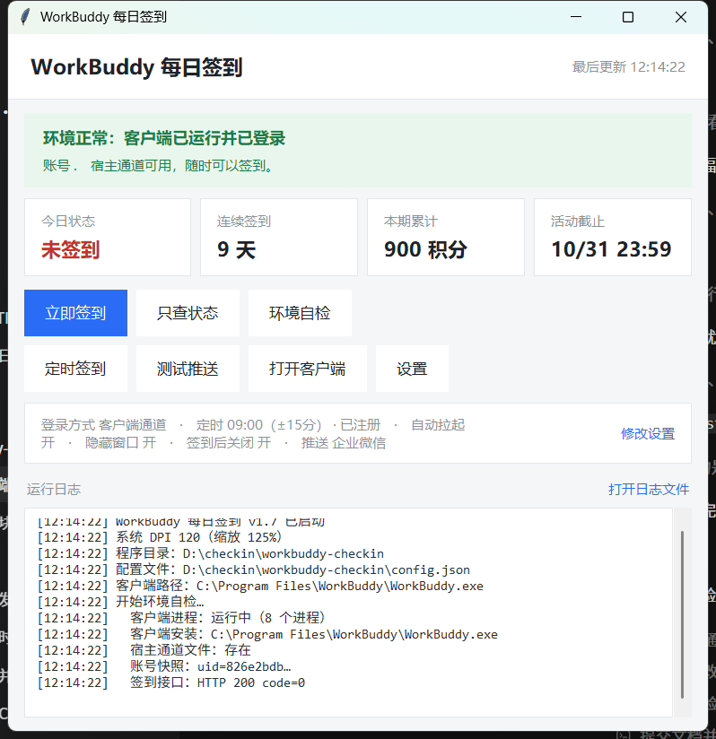
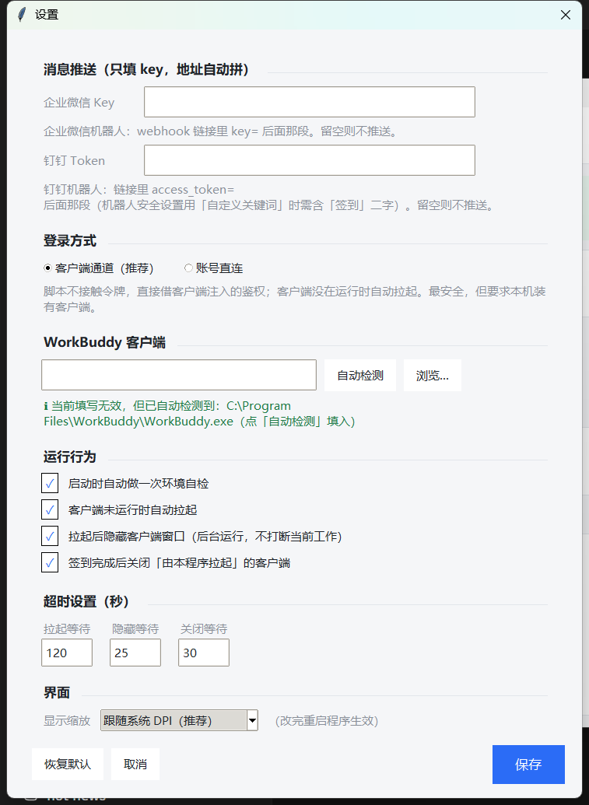

# WorkBuddy 每日签到

带图形界面的 WorkBuddy 每日签到助手 —— **双击就能用，目标机器不需要装 Python**。

自动检测客户端状态、一键签到、可选后台静默运行、支持企业微信 / 钉钉消息推送，
还能把定时签到写进 Windows 计划任务，**配好就关，系统里零常驻内存**。



---

## 目录

- [特性](#特性)
- [截图](#截图)
- [快速开始](#快速开始)
- [界面说明](#界面说明)
- [定时签到](#定时签到每天自动跑)
- [消息推送](#消息推送企业微信--钉钉)
- [配置项](#配置项)
- [从源码构建](#从源码构建)
- [项目结构](#项目结构)
- [常见问题](#常见问题)
- [免责声明](#免责声明)
- [更新日志](#更新日志)
- [License](#license)

---

## 特性

| 能力 | 说明 |
|---|---|
| **零依赖单文件** | PyInstaller 打包成一个 exe，目标机器不装 Python、不装任何库 |
| **环境自检** | 启动即检测「客户端装没装 / 在不在跑 / 通道通不通 / 登录没登录」，有问题直接挂横幅给按钮 |
| **后台静默运行** | 自动拉起客户端后立刻隐藏窗口，不抢焦点、不打断你手头的活 |
| **定时签到** | 界面里设置时间 + 随机抖动，写进 Windows 计划任务；程序本身不用常驻（占用 0 MB） |
| **消息推送** | 企业微信机器人 / 钉钉机器人，**只填 key**，地址程序自动拼 |
| **全程零弹窗** | 连底层的 PowerShell / tasklist 调用都不弹黑框（见 [常见问题](#常见问题)） |
| **高 DPI 适配** | 250% 缩放下字不会变小（[原理](docs/architecture.md#高-dpi为什么字会变小)） |

---

## 截图

| 主界面 | 设置 |
|---|---|
|  |  |

| 定时签到 |
|---|
|  |

---

## 快速开始

### 方式一：直接用打包好的 exe（推荐）

1. 从 [Releases](https://github.com/yehaia1/workbuddy-checkin/releases) 下载 `WorkBuddy签到.exe`（或自己[从源码构建](#从源码构建)）
2. 放到一个固定目录，双击运行
3. 第一次运行会在 exe 旁边自动生成 `config.json`
4. 想改配置就点界面上的「**设置**」，**日常不用碰这个文件**

> 建议把 exe 放在一个不会随手删掉的目录（例如 `D:\workbuddy-checkin\`）。
> 因为定时任务里记录的是 exe 的绝对路径，挪位置后需要重新点一次「应用到系统」。

### 方式二：从源码运行

需要 **Python 3.8+ 且带 tkinter**（官方 Windows 安装包默认包含）。本项目**零第三方依赖**，克隆即可跑：

```bash
git clone https://github.com/yehaia1/workbuddy-checkin.git
cd workbuddy-checkin
python checkin_gui.py
```

---

## 界面说明

界面从上到下：

| 区域 | 说明 |
|---|---|
| 顶部横幅 | 环境自检结果。绿 = 一切正常；黄 / 红 = 有问题，且横幅里**直接给处理按钮** |
| 四张卡片 | 今日状态 / 连续签到 / 本期累计 / 活动截止 |
| 按钮区 | 立即签到、只查状态、环境自检、**定时签到**、测试推送、打开客户端、设置 |
| 配置摘要 | 当前关键配置一览（含定时状态与下次执行时间），「修改设置」直接进设置窗口 |
| 运行日志 | 全部过程，方便排错；右上角可直接打开日志文件 |

设置窗口里能改：

| 分组 | 项目 |
|---|---|
| 消息推送 | 企业微信 / 钉钉机器人 **key**（只填 key，不用填整条链接；留空则不推送该渠道），配好可点「测试推送」验证 |
| WorkBuddy 客户端 | 客户端路径，带**「自动检测」**和「浏览…」按钮；下方实时显示检测结果 |
| 运行行为 | 启动时自动自检 / 未运行时自动拉起 / 拉起后隐藏窗口 / 签到后关闭自动拉起的客户端 |
| 超时设置 | 拉起等待、隐藏等待、关闭等待（秒） |
| 界面 | 显示缩放（跟随系统 DPI / 放大 10% / 25% / 50%，重启生效） |

保存后立刻写回 `config.json`，并重新自检一次。

---

## 定时签到（每天自动跑）

### 架构：三个角色分开

| 角色 | 负责什么 | 要不要一直开着 |
|---|---|---|
| **界面** | 设置时间、写入系统、平时手动签到 | **不用**，配好就能关 |
| **Windows 计划任务** | 到点叫醒执行者 | 系统负责，零常驻 |
| **exe 无界面入口** | 真正执行签到，跑完自动退出 | 只在触发那一刻存在 |

好处是：**不占内存、不怕重启、目标机器不用装 Python**。
界面配好即可关闭，系统里不会留下任何常驻进程。

### 怎么用

1. 主界面点「**定时签到**」
2. 勾上「启用每日自动签到」，填触发时间（默认 `09:00`；多个用逗号分隔，如 `09:00, 21:00`）
3. 填「随机抖动」（默认 `±15` 分钟，`0` = 准点执行）
4. 点「**应用到系统**」
5. 如果勾了「应用后自动关闭本程序」，界面会自己退出

之后随时打开程序，配置摘要里会直接显示进度，例如：

```
定时 09:00（±15分） · 下次 10/12 09:07 · 自动拉起 开 · ...
```

### 关于随机抖动

抖动用的是计划任务**原生的 `RandomDelay`**，不是脚本里 sleep：
到点前由系统自己在 `09:00 ~ 09:15` 之间挑一个时刻触发，所以「下次执行时间」
显示的是一个已经加过抖动的具体时刻（例如 `09:07`），不会卡在整点扎堆。

### 必须知道的行为

| 情况 | 表现 |
|---|---|
| 关机 / 休眠错过了时间点 | 已开启「错过后尽快启动」，开机后会补跑一次 |
| 到点时客户端没开 | 自动拉起 → 按设置隐藏窗口 → 签到 → 推送 → 关掉自己拉起的客户端 |
| 到点时客户端已开着 | 只签到，**不动**你正在用的客户端 |
| 触发后耗时 | 首次约 1 分钟（含 exe 解包与安全软件扫描），之后更快 |
| 重复触发 | 签到接口本身就是幂等的；任务也设了「不启动新实例」 |
| 在界面里点「定时签到」 | 全程不弹任何黑框窗口（v1.5 起） |

### 权限说明

计划任务以「**当前用户 + 仅登录时运行 + 普通权限**」注册，
所以**不弹 UAC，也不需要管理员权限**。代价是触发前提为"用户已登录"——本场景正好合适。

如果把 exe 挪到了别的目录，任务里记录的路径会失效。程序启动时能检测出来，
在「定时签到」里提示「任务指向的程序不是当前这个」，点一次「应用到系统」即可修复。

> 实现细节（为什么不用 `schtasks.exe`、怎么传中文路径）见
> [docs/architecture.md](docs/architecture.md#计划任务为什么不用-schtasksexe)。

---

## 消息推送（企业微信 / 钉钉）

配置里**只填 key**，程序按官方域名自动拼完整地址：

| 渠道 | 你需要填的 | 程序拼出来的 |
|---|---|---|
| 企业微信机器人 | webhook 链接 `?key=` 后面那段 | `https://qyapi.weixin.qq.com/cgi-bin/webhook/send?key=<你的key>` |
| 钉钉机器人 | 链接 `access_token=` 后面那段 | `https://oapi.dingtalk.com/robot/send?access_token=<你的token>` |

在「设置 → 消息推送」里填好，点「**测试推送**」可以向所有已配置渠道各发一条验证。

> - 兼容性：如果把整条链接粘进来也能识别（会自动把 key 抽出来），但**推荐只填 key**。
> - 看着像链接却抽不出参数时程序会拒发，避免把消息误推到第三方地址。
> - 钉钉机器人安全设置若选「自定义关键词」，关键词需包含「签到」二字（消息文案里已带）。
> - 两个渠道可同时启用，**推送失败互不影响**。

---

## 配置项

配置文件是 exe 旁边的 `config.json`（首次运行自动生成）。样例见
[`config.example.json`](config.example.json)。

| 键 | 默认 | 含义 |
|---|---|---|
| `wecom_key` | `""` | 企业微信机器人 key（只填 key）。留空则不推送该渠道 |
| `dingtalk_key` | `""` | 钉钉机器人 access_token（只填 token）。留空则不推送该渠道 |
| `wecom_webhook` / `dingtalk_webhook` | `""` | 兼容旧配置：可直接填完整地址，优先于上面的 key |
| `workbuddy_exe` | `""` | 客户端路径。**留空 = 自动探测**（推荐） |
| `launch_workbuddy` | `true` | 宿主未运行时自动拉起客户端 |
| `launch_timeout` | `120` | 拉起后等待 IPC 就绪的最长秒数 |
| `hide_window` | `true` | 拉起后隐藏客户端主窗口（后台运行） |
| `hide_window_timeout` | `25` | 等待主窗口出现并隐藏的最长秒数 |
| `close_after_checkin` | `true` | 客户端由本程序拉起时，签到完成后自动关闭它 |
| `close_timeout` | `30` | 优雅关闭等待进程退出的最长秒数 |
| `close_force` | `true` | 优雅关闭超时后强制结束进程树（清干净残留） |
| `ui_scale` | `0` | 界面缩放：`0` 跟随系统 DPI，或 `110` / `125` / `150` |
| `auto_env_check` | `true` | 启动时是否自动自检 |
| `schedule_enabled` | `false` | 是否已启用每日定时签到 |
| `schedule_times` | `["09:00"]` | 触发时间点列表，如 `["09:00", "21:00"]` |
| `schedule_jitter` | `15` | 随机抖动分钟数，`0` = 准点执行 |
| `exit_after_apply` | `true` | 应用定时设置后自动关闭本程序 |

> ⚠️ **定时相关的四项请用界面改**：因为改完还需要同步到系统计划任务里，
> 只编辑这个文件**不会**影响系统任务。界面上点「应用到系统」才会真正生效。

> ⚠️ `config.json` 里可能存有你的机器人 key，已经在 `.gitignore` 中排除，
> **不要把它提交或分享出去**。

---

## 从源码构建

```bash
# 1) 装 PyInstaller（装到本地隔离目录，不污染系统环境）
python -m pip install --target .build/pylibs pyinstaller

# 2) 一键打包（脚本会自动处理动态依赖与解释器校验）
python build_exe.py
```

产物在 `dist/WorkBuddyCheckin.exe`，改名成 `WorkBuddy签到.exe` 也能正常运行。

`build_exe.py` 帮你避开了两个**打包了才知道的坑**：

1. **动态导入的依赖要手动声明**：`workbuddy_ipc` 是运行时从客户端安装目录动态 import 的，
   PyInstaller 静态分析看不到它，它依赖的 `hmac` / `secrets` / `socket` / `ssl` 不会被收集，
   打出来的 exe 会报 `ModuleNotFoundError: No module named 'hmac'`，被误判成"客户端未登录"。
2. **打包用的解释器必须带 tkinter**：用不带 tkinter 的解释器打包，PyInstaller
   **不报任何错**，只是悄悄少收集 `_tkinter.pyd` 和 tcl/tk 运行时，打出来的 exe
   一启动就崩。唯一线索是体积小掉约 3 MB（正常约 11 MB，损坏版约 8 MB）。
   脚本会自动挑一个带 tkinter 的解释器（也可 `--python <路径>` 指定），
   并在打包后跑一次 `--selftest` 校验，不通过就直接报错、不放行。

---

## 项目结构

```
workbuddy-checkin/
├── checkin_gui.py            # tkinter 图形界面（入口）
├── workbuddy_checkin.py      # 核心逻辑：IPC、签到三步、推送、环境自检、客户端定位
├── wb_host.py                # Windows 侧辅助：进程/路径/窗口/登录态
├── wb_task.py                # Windows 计划任务管理
├── win_quiet.py              # 让子进程不弹控制台窗口
├── build_exe.py              # 一键打包（含解释器校验）
├── probe_hidden_launch.py    # 后台拉起探针（只读，用于验证隐藏窗口可行性）
├── run_checkin.bat           # 命令行入口（无界面）
├── setup_task.bat            # 旧式计划任务注册（见 docs/architecture.md）
├── config.example.json       # 配置样例
├── tools/
│   └── no_popup_check.py     # 回归检查：运行程序时是否弹出控制台黑框
└── docs/
    ├── architecture.md       # 架构与实现细节
    └── troubleshooting.md    # 排查手册
```

---

## 常见问题

**Q：点「定时签到」时冒出一个 PowerShell 窗口？**
v1.5 已修复。原因是窗口程序自身没有控制台，拉起 `powershell.exe` 这类控制台程序时
Windows 会给它**新建一个控制台窗口**。修法是所有子进程调用统一加
`creationflags=CREATE_NO_WINDOW`。详见 [docs/troubleshooting.md](docs/troubleshooting.md#点按钮闪出黑框)。

**Q：定时到点了但没签到？**
先跑 `WorkBuddyCheckin.exe --sched-status` 看一眼任务状态（不开界面、不弹窗），
再按 [docs/troubleshooting.md](docs/troubleshooting.md#定时不生效) 逐步排查。

**Q：提示"未检测到 WorkBuddy 客户端"，但明明装了？**
自检分了「装没装」和「在不在跑」两层判断。没在跑会被明确提示为
「已安装，但当前没有运行」，并在设置里给出检测到的路径。
如果路径没找到，可以在「设置 → WorkBuddy 客户端」手动指定，或用「自动检测」。

**Q：能同时用界面里的定时和 `setup_task.bat` 吗？**
**不建议**，会重复触发。界面里点「应用到系统」时会自动清理旧的
`_0900` / `_2100` 任务。旧方式现在只留给"不想用界面"的机器。

更多问题见 [docs/troubleshooting.md](docs/troubleshooting.md)。

---

## 免责声明

- 本项目是**非官方的个人自动化工具**，与 WorkBuddy 官方无关。
- 签到接口的鉴权头**由客户端主进程注入**，本程序不接触、不存储任何账号令牌。
  因此客户端必须先开着并登录，这是硬前提。
- 请自行确认你的使用方式符合相关服务条款。**使用风险自负**。
- `config.json` 中可能包含你的机器人 key，请勿提交到公开仓库。

---

## 更新日志

见 [CHANGELOG.md](CHANGELOG.md)。

---

## License

[MIT](LICENSE)
