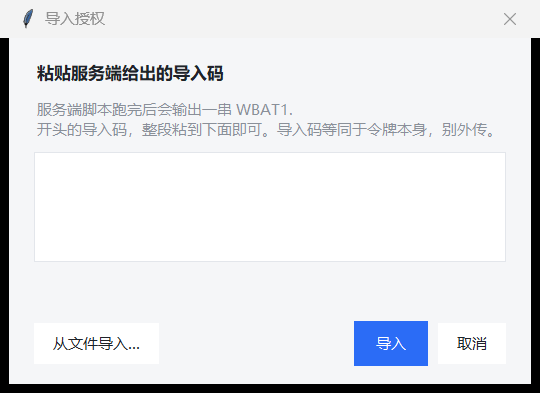

# 使用手册

面向"我要把它跑起来"的读者。设计原因见 [architecture.md](architecture.md)，
出问题先看 [troubleshooting.md](troubleshooting.md)。

---

## 0. 先确认你用的是哪种运行方式

| | 本地运行 | 独立运行 |
|---|---|---|
| 启动 | `python run.py` | 双击 `WorkBuddy签到.exe` |
| 配置 | `<仓库根目录>/config.json` | `<exe 所在目录>/config.json` |
| 日志 | `<仓库根目录>/checkin.log` | `<exe 所在目录>/checkin.log` |
| 令牌 | `<仓库根目录>/auth_oauth.json` | `<exe 所在目录>/auth_oauth.json` |
| 计划任务执行 | `pythonw run.py --run` | `WorkBuddy签到.exe --run` |

两套数据目录互不影响：根目录那份用于调试，exe 旁边那份才是真正在跑的。
**排查问题时先确认自己在看哪一份日志。**

界面启动后，日志区第一行就会写明"运行方式"和"程序目录"。

---

## 1. 账号授权

签到接口需要登录态。本工具用 CodeBuddy CLI 的设备授权流程换一份明文令牌，
之后纯 HTTP 调用，不启动客户端。

### 方式 A：本机授权（默认）

1. 点 **立即授权**
2. 自动打开浏览器 → 登录 → 确认
3. 窗口检测到结果后自动关闭，授权状态变成"有效"

有效期约 28 天。程序会在到期前 5 天自动刷新；遇到 401 会刷新一次再重试。

### 方式 B：推到手机

1. 先在「设置推送」里配好至少一个渠道，并发一条测试确认能收到
2. 点 **推到手机授权**
3. 链接发到你的企业微信 / 钉钉 → 手机上点开登录
4. 本机在后台轮询，拿到令牌后窗口自己关掉

适合目标机器没有浏览器，或人不在机器前。

### 方式 C：服务端授权后导入

服务器上执行：

```bash
python src/wb_auth_server.py
```

它会：生成授权链接 → 推到配置的渠道 → 等人扫码 → 输出一段 `WBAT1.…` 导入码。

然后在 Windows 端点 **导入授权**，粘贴导入码即可（也可以给一个包含导入码的文件）。



> **令牌只能有一份。** `refreshToken` 每次刷新都会轮换。服务端默认不落盘、
> 只给导入码，就是为了让 Windows 端独占续期。若两台机器各存一份，先刷新的一方
> 会让另一方立刻失效（返回码 `12153`）。

### 无人值守：`--handoff`

```bash
# 服务器：授权成功后开一个一次性端口等取件
python src/wb_auth_server.py --handoff --port 8787

# Windows：执行它打印出来的命令
WorkBuddy签到.exe --pull-token "http://<服务器>:8787/token" "<secret>"
```

取件成功后端口立即关闭，服务器不留令牌。端口需要能从 Windows 访问到。

---

## 2. 每日定时

点 **设置定时**：

| 项 | 说明 |
|---|---|
| 启用 | 勾上才会写入计划任务；取消勾选会删除任务 |
| 时间 | `HH:MM`，可加多个（逗号分隔），例如 `09:00, 21:30` |
| 随机抖动 | 0–60 分钟。设 15 表示在 09:00–09:15 之间随机触发 |
| 应用后退出 | 默认开启。定时写好就关掉程序，系统里不留常驻进程 |

点 **应用到系统** 后：

- 任务名固定为 `WorkBuddyCheckin`
- 触发时执行 `<程序> --run`，无界面签到，退出码写回任务历史
- 程序目录变更（exe 挪位置）后，任务里的绝对路径会失效，需要重新应用一次

> 不要直接编辑 `config.json` 里的 `schedule_*`：那只是程序记的状态，
> 不会同步进系统。以界面操作为准。

查看系统里的实际状态：

```bash
WorkBuddy签到.exe --sched-status
# 或本地运行
python run.py --sched-status
```

---

## 3. 消息推送

支持企业微信、钉钉群机器人，**只填 key**：

| 渠道 | 从哪取 |
|---|---|
| 企业微信 | 群机器人 webhook 里 `key=` 之后的部分 |
| 钉钉 | 自定义机器人 webhook 里 `access_token=` 之后的部分 |

地址由程序拼接，不要粘贴整条链接。

在「设置推送」里：

- 勾选要用的渠道（`push_channels`）——**勾选才是开关**，填了 key 不勾也不会发
- key 留空的渠道会被跳过
- 点 **发送测试** 验证；返回非 0 会显示服务端的错误信息

推送内容包含：今天是否签到、本次积分、连续天数、累计积分、活动截止时间。
签到失败时推送错误原因（网络、授权失效等）。

---

## 4. 服务端脚本

`src/wb_auth_server.py`，零依赖，Python 3.7+。

```bash
python src/wb_auth_server.py                     # 默认：链接→推送→等扫码→导入码
python src/wb_auth_server.py --channel dingtalk  # 强制走某个渠道
python src/wb_auth_server.py --timeout 900       # 等授权的秒数
python src/wb_auth_server.py --handoff --port 8787
python src/wb_auth_server.py --push-only --url "https://..."
python src/wb_auth_server.py --save-token token.json   # 显式在服务器留一份
```

- 默认读**仓库根目录**的 `config.json`；服务器上没有仓库时用 `--config` 指定
- `--handoff` 会打印 Windows 端该执行的命令，复制即用
- 退出码：`0` 成功、`1` 推送失败（`--push-only`）、`2` 授权超时 / 参数问题 /
  没有可用渠道、`3` 申请授权或响应异常、`4` handoff 没人来取令牌

---

## 5. 配置项

`config.json` 由程序生成，**改之前先关程序**（界面退出时会写回）。

| 键 | 默认 | 说明 |
|---|---|---|
| `push_channels` | `["wecom"]` | 启用的推送渠道，可选 `wecom` / `dingtalk` |
| `wecom_key` | `""` | 企业微信机器人 key |
| `dingtalk_key` | `""` | 钉钉机器人 access_token |
| `oauth_token_file` | `""` | 令牌路径，留空 = 数据目录下 `auth_oauth.json` |
| `oauth_auth_timeout` | `300` | 等授权完成的秒数 |
| `schedule_enabled` | `false` | 是否已写入计划任务 |
| `schedule_times` | `["09:00"]` | 触发时间点 |
| `schedule_jitter` | `15` | 随机抖动分钟数 |
| `exit_after_apply` | `true` | 应用定时后自动退出 |

`config.json`、`auth_oauth.json`、`checkin.log` 都已在 `.gitignore` 中排除。

---

## 6. 退出码

计划任务的"上次结果"就是进程退出码：

| 码 | 含义 | 要不要管 |
|---|---|---|
| `0` | 成功（含"今天已签到"） | 不用 |
| `1` | 签到失败（接口 / 未知） | 看日志 |
| `2` | 需要处理：未授权、令牌失效、推送没配好 | 按提示处理 |
| `3` | 网络或授权协议异常（请求失败、响应缺字段、领取令牌失败） | 先看网络 |
| `267011` 等 | 计划任务自身状态（尚未运行过等） | **不是失败** |

---

## 7. 数据与隐私

- 令牌是明文的，放在 `auth_oauth.json`；文件权限继承目录，不要放共享盘
- 导入码 `WBAT1.…` 等同于令牌，不要发群、不要截图
- 推送 key 存在 `config.json`，不要提交到公开仓库
- 日志只记录结果与错误摘要，不记录令牌内容
